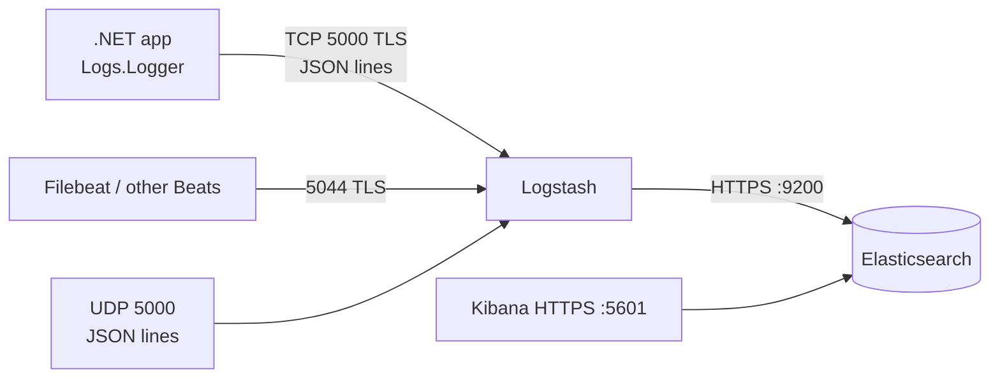

# ELK-integration

A Docker Compose template for an Elasticsearch, Logstash, and Kibana stack with TLS on the HTTP and Beats endpoints, plus a small .NET 8 client library that ships JSON logs to Logstash over TCP.

The repository already has a Russian README. That file refers to a `src/` directory and to docs such as `KIBANA_ACCESS.md`, `PASSWORDS.md`, `INTEGRATION_GUIDE.md`, and `docker-compose.override.yml`, which are not in the tree. The stack actually lives under **`elk-src/`**. This draft follows the files that are in the repo.

<!-- Screenshot: add a Kibana Discover screenshot here, e.g.  -->

## Features

- **ELK 8.19.11** — Elasticsearch (single node), Logstash, and Kibana, all started from `elk-src/docker-compose.yml`.
- **TLS** — HTTP and transport TLS for Elasticsearch, HTTPS for Kibana, TLS for Logstash TCP (`5000`) and Beats (`5044`). A `generate-certs.sh` script builds a local CA and per-service certificates (SAN includes `localhost` and `127.0.0.1` where relevant).
- **Logstash inputs** — TCP 5000 (JSON lines, TLS), UDP 5000 (JSON lines, no TLS), and Beats 5044 (TLS). Output index pattern is `logs-YYYY.MM.dd`.
- **.NET 8 logging library** (`elk-src/examples/dotnetIntegration/Logs`, package id `ELKIntegration.Logs`) — a `Logger` that formats a `LogEntry` as camelCase JSON (`@timestamp`, `level`, `message`, `application`, `environment`, optional `correlationId`, `userId`, exception, and custom properties) and writes it to Logstash over TCP, with optional SSL and CA validation.
- **Runnable example** — `elk-src/examples/dotnet/Program.cs` sends a few sample log lines to `localhost:5000` with TLS. `ProgramWithSSL.cs` is a Serilog-based sketch and is **excluded** from compilation (`Compile Remove` in the example `.csproj`).

## Tech stack

- Elasticsearch, Logstash, Kibana **8.19.11** (official Elastic images)
- Docker Compose, OpenSSL (certificate script)
- .NET 8 class library and console example (no extra NuGet logging packages in the library; it uses `TcpClient` / `SslStream`)
- MIT license

## Architecture



## How to run

Prerequisites: **Docker**, **OpenSSL** (for the cert script). The example also needs the **.NET 8 SDK**.

All Compose and cert commands are run from `elk-src/` (the script writes `./certs`, and Compose mounts `./certs` and `./logstash/pipeline/logstash.conf`).

### 1. Environment file

```bash
cd elk-src
cp .env.example .env
```

Compose reads `.env` from this directory. `.env.example` sets `ELASTICSEARCH_USER`, `ELASTIC_PASSWORD` (default `test_password_123`), `KIBANA_SYSTEM_USER`, `KIBANA_SYSTEM_PASSWORD`, and three Kibana `XPACK_*_ENCRYPTIONKEY` values (each must be at least 32 characters). Change these before any non-local use.

### 2. Certificates

```bash
./generate-certs.sh
```

This creates `elk-src/certs/ca`, `elk-src/certs/elasticsearch`, `elk-src/certs/logstash`, and `elk-src/certs/kibana`. Compose will not start cleanly until those files exist.

### 3. Start the stack

```bash
docker compose up -d
```

Endpoints (after a healthy start):

| Service        | URL / port                         | Notes |
|----------------|------------------------------------|--------|
| Elasticsearch  | `https://localhost:9200`           | User `elastic`, password from `ELASTIC_PASSWORD` |
| Kibana         | `https://localhost:5601`           | Sign in as `elastic`, not `kibana_system` |
| Logstash TCP   | `localhost:5000` (TLS)             | JSON lines |
| Logstash UDP   | `localhost:5000`                   | JSON lines, no TLS |
| Logstash Beats | `localhost:5044` (TLS)             | |
| Logstash API   | `localhost:9600`                   | |
| ES transport   | `9300`                             | |

Self-signed certificates will make browsers and `curl` warn; `curl -k` is appropriate only for this local setup.

Kibana talks to Elasticsearch as `kibana_system`. That built-in user does not use `ELASTIC_PASSWORD` by default. After Elasticsearch is up, reset the password and put the result in `.env` as `KIBANA_SYSTEM_PASSWORD`, then restart Kibana:

```bash
docker exec -it elasticsearch bin/elasticsearch-reset-password \
  -u kibana_system \
  --url https://elasticsearch:9200 \
  --force
```

### 4. Smoke-check Elasticsearch

```bash
curl -k -u elastic:"$ELASTIC_PASSWORD" https://localhost:9200/_cluster/health
docker compose logs logstash
```

(Use the same password you set in `.env`. The Compose default fallback is `test_password_123`.)

### 5. Run the .NET example

The solution file `ELK-integration.sln` still points at `src/examples/...`, which does not exist. Run the project file from `elk-src` (the directory used above), after the stack is up and certs exist (the example csproj copies `elk-src/certs/ca/ca.crt` when that file is present):

```bash
dotnet restore examples/dotnet/ElkIntegration.csproj
dotnet run --project examples/dotnet/ElkIntegration.csproj
```

The example connects to `localhost:5000` with TLS. If a CA file is found at `certs/ca/ca.crt` (output or working directory), it is used; otherwise the client sets `AcceptAnyCertificate`.

Library usage (from the compiled example):

```csharp
using Logs.Domain;
using Logs.Infrastructure;

using var logger = new Logger(new LogstashOptions
{
    Host = "localhost",
    Port = 5000,
    UseSsl = true,
    CaCertificatePath = "certs/ca/ca.crt",
    AcceptAnyCertificate = false
});

logger.Log(new LogEntry(
    Timestamp: DateTimeOffset.UtcNow,
    Level: LogLevel.Info,
    Message: "Application started",
    Application: "my-dotnet-app",
    Environment: "Development"));
```

## Project structure

```
ELK-integration.sln          # paths inside still say src/ — prefer the csproj paths below
LICENSE
elk-src/
  .env.example
  docker-compose.yml
  generate-certs.sh
  logstash/pipeline/logstash.conf
  examples/dotnet/           # console example (Program.cs)
  examples/dotnetIntegration/Logs/  # ELKIntegration.Logs library
```

## Security notes

The default `ELASTIC_PASSWORD` and encryption keys in `.env.example` are for local experiments only. Use a private `.env`, trusted certificates, and CA-based validation (`AcceptAnyCertificate = false`) if this is ever exposed beyond a developer machine.
